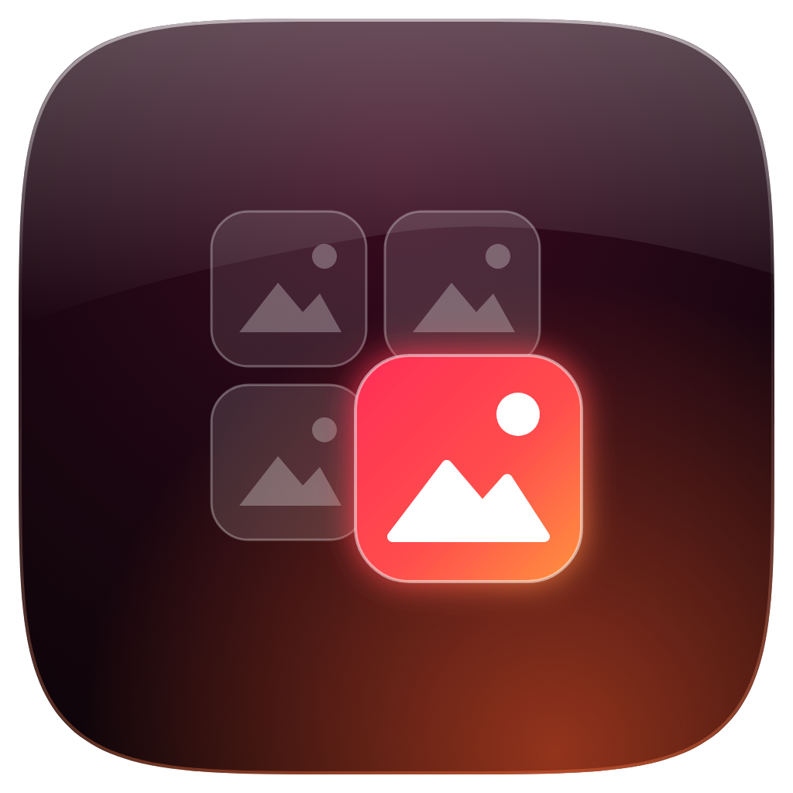
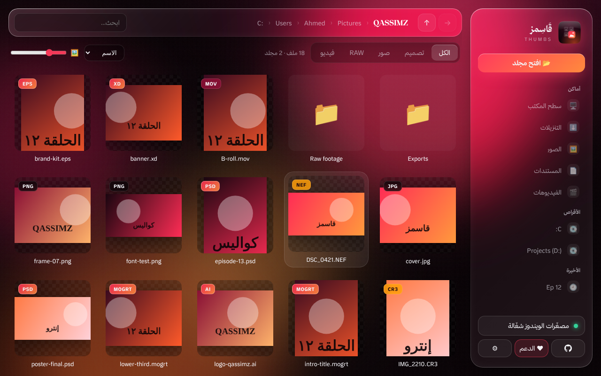
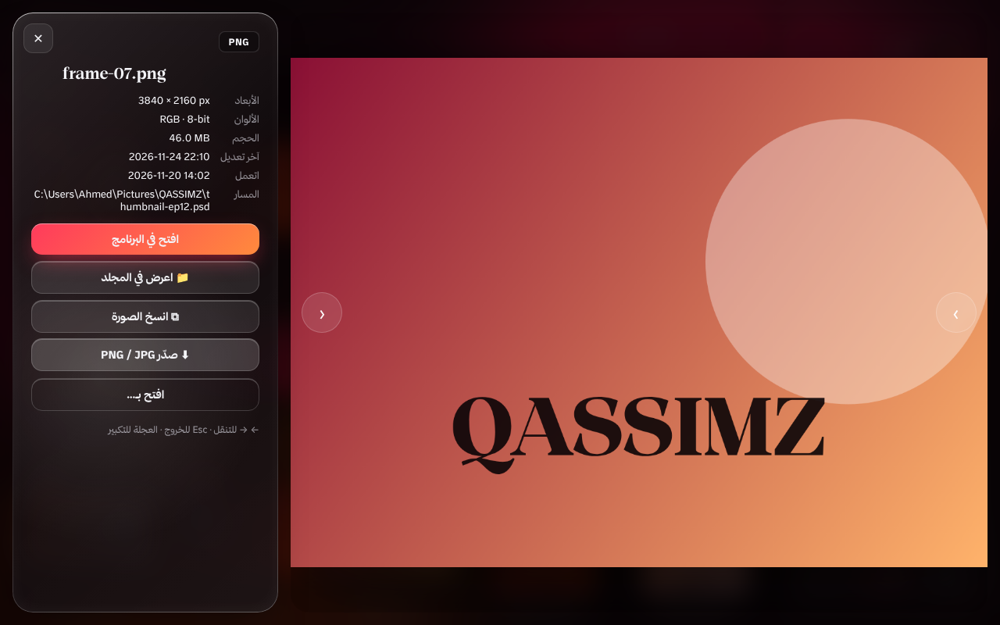

<div align="center">



# QASSIMZ Thumbs

**ملفات PSD و AI وكل ملفات التصميم والـ RAW بتظهر كصور في الويندوز، ومعاها عارض بشكل قَاسِمز.**

من **أحمد قاسم — قَاسِمز** · مجاني ومفتوح المصدر · Windows 10/11

[⬇️ تحميل آخر إصدار](https://github.com/ahmedqassimtv-commits/qassimz-thumbs/releases/latest) ·
[🐞 الدعم والإبلاغ عن مشكلة](https://github.com/ahmedqassimtv-commits/qassimz-thumbs/issues) ·
[🌐 qassimz.com](https://qassimz.com)



</div>

---

## ✨ بيعمل إيه

### 1) مصغّرات جوه الويندوز نفسه
بعد التسطيب، الملفات دي بتظهر **بصورتها** في File Explorer بدل الأيقونة الفاضية:

| النوع | الصيغ |
|---|---|
| 🎨 أدوبي | **PSD · PSB** · **AI** · **EPS** · INDD · **XD** · **MOGRT** |
| ✏️ تصميم | Sketch · Affinity (Designer / Photo / Publisher) · CorelDRAW · Clip Studio |
| 🖌️ رسم | Krita · OpenRaster · Procreate |
| 📷 RAW (اختياري) | CR2 · CR3 · NEF · ARW · DNG · RAF · ORF · RW2 · PEF · SRW … |

### 2) عارض QASSIMZ Thumbs
- يفتح أي مجلد ويعرض **كل حاجة** كمصغّرات: التصميمات والصور والفيديوهات (WebP / HEIC / MP4 …) وحتى أيقونات البرامج.
- **تكبير** بدبل كليك، والأسهم للتنقل، والعجلة للزوم والسحب.
- تفاصيل الملف (الأبعاد، والألوان RGB / CMYK، والـ bit depth، والحجم، والتاريخ).
- **انسخ الصورة** أو **صدّرها PNG / JPG** (حتى من PSD أو AI)، أو افتحها في البرنامج بتاعها.
- فلترة (تصميم / صور / RAW / فيديو)، وبحث، وترتيب، والتحكم في حجم المصغّرات.
- اسحب أي مجلد وارميه على البرنامج، أو كليك يمين على المجلد واختار **«اعرض بـ QASSIMZ Thumbs»**.
- **تحديث تلقائي** من GitHub من غير صلاحيات أدمن.



## 🚀 التسطيب
1. نزّل `QASSIMZ-Thumbs-Setup-x.x.x.exe` من [Releases](https://github.com/ahmedqassimtv-commits/qassimz-thumbs/releases/latest).
2. سطّبه (فيه اختيار لمصغّرات RAW).
3. لو ظهرت شاشة SmartScreen: **More info ← Run anyway**.
4. لو لسه شايف أيقونات في مجلد كنت فاتحه قبل كده: افتح البرنامج ← ⚙ ← **«حدّث مصغّرات الويندوز»**.

> **ملاحظة PSD:** البرنامج بيعرض الصورة المدمجة (composite). لو الملف اتحفظ من غير **Maximize Compatibility** بيعرض المصغّر الصغير اللي فوتوشوب حطه جوه الملف.
> **AI / INDD:** بيستخدم المعاينة اللي إليستريتور حاططها جوه الملف (XMP).

## 🛠️ للمطورين

```
src/Shell/Extractor.cs          فك الصيغ: PSD/PSB، XMP، DOS-EPS، ZIP (XD/Sketch/Krita/MOGRT…)، JPEG/PNG مدمجة (RAW/Affinity)
src/Shell/ThumbnailProvider.cs  IThumbnailProvider للويندوز + التسجيل في HKCU
src/Viewer/                     العارض (WinForms + WebView2) والواجهة في ui/
installer/setup.iss             الـ installer (من غير أدمن)
```

```bash
dotnet build QassimzThumbs.sln -c Release
```

**نشر إصدار جديد:** غيّر `AppVersion` في `src/Viewer/MainForm.cs` واعمل push على `main`. GitHub Actions هيبني الـ Setup والنسخة Portable وينزّلهم في Releases، والبرنامج المتسطب هيحدّث نفسه.

## ❤️ الدعم
- مشكلة أو صيغة عايزها تتضاف؟ [افتح Issue](https://github.com/ahmedqassimtv-commits/qassimz-thumbs/issues).
- عجبك البرنامج؟ اديله ⭐.

---
<div align="center">© 2026 أحمد قاسم — قَاسِمز · MIT License</div>
