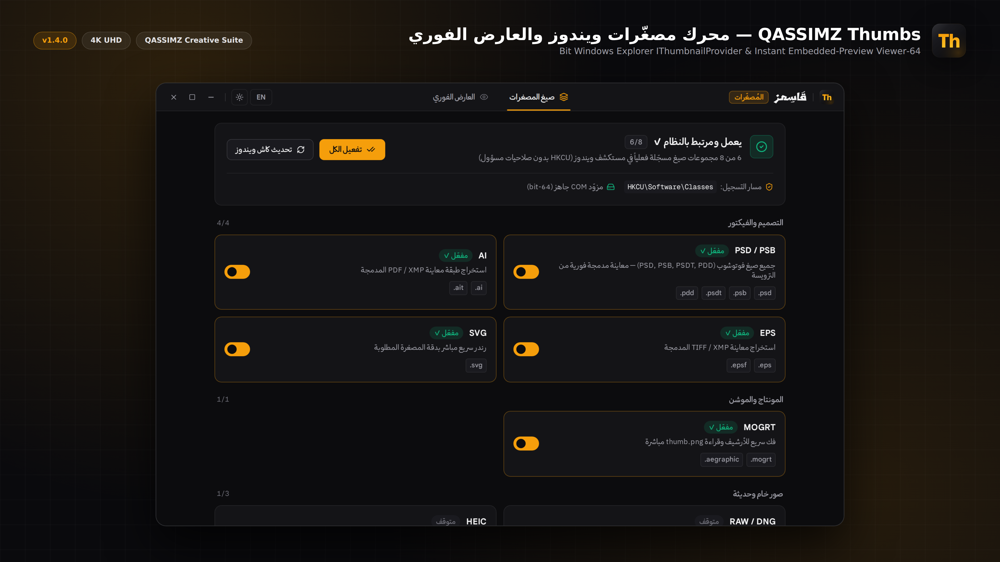

# QASSIMZ Thumbs
### محرك مصغّرات ويندوز والعارض الفوري

<!-- اللغات المدعومة أسفل اللوجو مباشرة -->

   

  
  
  

<em>64-Bit Windows Explorer IThumbnailProvider & Instant Embedded-Preview Viewer</em>

 

---

## 1. نظرة عامة

محرك أصلي (64-bit COM `IThumbnailProvider`) يعرض مصغّرات ملفات التصميم والمونتاج والصور الخام داخل مستكشف ويندوز بسرعة فائقة عبر استخراج المعاينة المدمجة، مع عارض فوري مدمج بهوية **Darkroom Editorial Monochrome**.

> **ملاحظة:** جميع الصيغ (بما فيها كافة صيغ فوتوشوب `.psd`, `.psb`, `.psdt`, `.pdd`) تُسجَّل مباشرة تحت `HKCU\Software\Classes` بدون صلاحيات مسؤول (Zero UAC).

---

## 2. المميزات الرئيسية

1. **دعم كامل لصيغ فوتوشوب:** قراءة فورية من الترويسة لجميع صيغ Photoshop (`.psd`, `.psb`, `.psdt`, `.pdd`).
2. **دعم صيغ التصميم والموشن:** عرض مصغرات `.ai`, `.eps`, `.svg`, `.mogrt`, `.aegraphic`.
3. **دعم الصور الخام والحديثة:** استخراج Embedded JPEG فوري لملفات `RAW` (`CR3`, `CR2`, `ARW`, `NEF`, `DNG`) و `HEIC` و `WEBP`.
4. **تسجيل فوري بدون صلاحيات مسؤول (HKCU):** تفعيل وإيقاف كل صيغة مباشرة تحت `HKCU\Software\Classes` بدون UAC.
5. **تحديث حقيقي لكاش ويندوز:** تنظيف آمن لملفات `thumbcache_*.db` وإشعار فوري لـ Windows Explorer عبر `SHChangeNotify`.
6. **العارض الفوري (Quick Viewer):** سحب وإفلات أي ملف لمعاينته فوق خلفية Checkerboard للشفافية مع عرض الأبعاد والحجم وزمن الاستخراج بالـ `ms`.

---

## 3. التحميل والتثبيت

1. **الطريقة الموصى بها (عبر QASSIMZ Hub):**
   - حمّل وافتح [**QASSIMZ Hub**](https://github.com/ahmedqassimtv-commits/qassimz-hub/releases/latest) لتثبيت **QASSIMZ Thumbs** وتلقي جميع التحديثات التفاضلية (`.qpkg`) تلقائياً بضغطة زر.
2. **التحميل المباشر من GitHub Releases:**
   - افتح صفحة [**أحدث إصدار (v1.4.0)**](https://github.com/ahmedqassimtv-commits/qassimz-thumbs/releases/latest).
   - حمّل ملف المثبّت (`Setup.exe`) للتثبيت العادي بدون صلاحيات مسؤول، أو النسخة المحمولة (`Portable.zip`) إن وجدت.

---

## 4. متطلبات التشغيل

1. نظام التشغيل: Windows 10 / 11 (64-bit).
2. لا يتطلب صلاحيات مسؤول (يعمل بالكامل على مستوى المستخدم `HKCU`).

---

## 5. منظومة قَاسِمز الإبداعية (QASSIMZ Creative Suite)

| # | التطبيق | الوصف | المستودع |
|---:|---|---|---|
| 1 | **QASSIMZ Hub** | مركز ومنظومة قَاسِمز الإبداعية | [GitHub](https://github.com/ahmedqassimtv-commits/qassimz-hub) |
| 2 | **QASSIMZ Thumbs** **(الحالي)** | محرك مصغّرات ويندوز والعارض الفوري | [GitHub](https://github.com/ahmedqassimtv-commits/qassimz-thumbs) |
| 3 | **QASSIMZ FONTs** | مدير الخطوط الاحترافي والمزامنة السحابية | [GitHub](https://github.com/ahmedqassimtv-commits/qassimz-fonts) |
| 4 | **QASSIMZ Studio** | استوديو المونتاج والتحرير الاحترافي | [GitHub](https://github.com/ahmedqassimtv-commits/qassimz-studio) |
| 5 | **QASSIMZ Producer** | مساحة إدارة الإنتاج وصناعة المحتوى | [GitHub](https://github.com/ahmedqassimtv-commits/qassimz-producer) |
| 6 | **QASSIMZ Music** | مشغّل الموسيقى ومكتبة الصوتيات للمونتاج | [GitHub](https://github.com/ahmedqassimtv-commits/qassimz-music) |
| 7 | **QDM — QASSIMZ Download Manager** | مدير التحميل السريع متعدد المسارات | [GitHub](https://github.com/ahmedqassimtv-commits/qdm) |
| 8 | **QASSIMZ Organizer** | منظّم مجلدات المشاريع والملفات الإبداعية | [GitHub](https://github.com/ahmedqassimtv-commits/qassimz-organizer) |
| 9 | **QASSIMZ Study** | منصة المذاكرة والتركيز وإدارة الدروس | [GitHub](https://github.com/ahmedqassimtv-commits/qassimz-study) |
| 10 | **QASSIMZ VOX FX** | إضافة المؤثرات البصرية والصوتية لـ Premiere Pro | [GitHub](https://github.com/ahmedqassimtv-commits/qassimz-vox-fx) |
| 11 | **QASSIMZ Captions** | إضافة الترجمة والكتابة التلقائية لـ Premiere Pro | [GitHub](https://github.com/ahmedqassimtv-commits/qassimz-captions) |
| 12 | **QASSIMZ Footage** | إضافة البحث واستيراد اللقطات لـ Premiere Pro | [GitHub](https://github.com/ahmedqassimtv-commits/qassimz-footage) |
| 13 | **QASSIMZ MOGRT Hub** | مكتبة ومدير قوالب MOGRT لـ Premiere Pro | [GitHub](https://github.com/ahmedqassimtv-commits/qassimz-mogrt-hub) |
| 14 | **QASSIMZ MOGRT Maker** | صانع قوالب MOGRT الاحترافي لـ Premiere Pro | [GitHub](https://github.com/ahmedqassimtv-commits/qassimz-mogrt-maker) |
| 15 | **QASSIMZ Export** | إضافة التصدير الذكي السريع لـ Premiere Pro | [GitHub](https://github.com/ahmedqassimtv-commits/qassimz-export) |

---

  © 2026 <strong>QASSIMZ Creative Suite</strong> — Ahmed Qassim. جميع الحقوق محفوظة.

